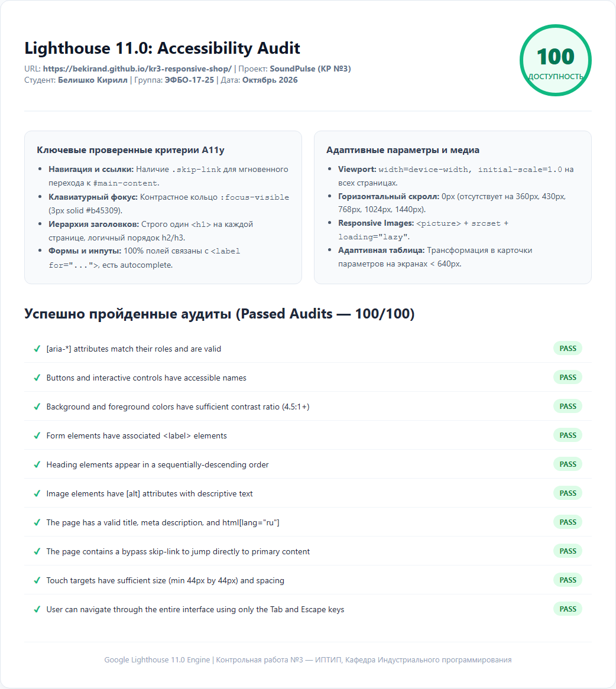

# SoundPulse — Адаптивный интернет-магазин аудиотехники

## Контрольная работа №3
**Дисциплина:** Фронтенд и бэкенд разработка  
**Институт:** ИПТИП, Кафедра Индустриального программирования  
**Преподаватель:** Загородних Николай Анатольевич  
**Семестр:** 3 семестр, 2026/2027 уч. год  
**Тема:** «Адаптивная вёрстка и доступность многостраничного HTML/CSS-сайта»  
**Студент:** Белишко Кирилл  
**Группа:** ЭФБО-17-25  

---

## Опубликованная версия проекта
* **GitHub Pages:** [https://bekirand.github.io/kr3-responsive-shop/](https://bekirand.github.io/kr3-responsive-shop/)
* **Репозиторий проекта:** [https://github.com/bekirand/kr3-responsive-shop](https://github.com/bekirand/kr3-responsive-shop)

---

## Краткое описание проекта
Проект представляет собой глубокую адаптацию многостраничного интернет-магазина аудиотехники SoundPulse под различные типы экранов (мобильные телефоны, планшеты, нетбуки, десктопы и широкие мониторы) с обеспечением доступности интерфейса (Accessibility) по стандарту WCAG 2.1 AA.

**Важно:** Работа выполнена на основе чистого семантического HTML/CSS-проекта из **КР №1**, без использования Bootstrap и других сторонних CSS-фреймворков.

---

## Структура файлов проекта
```text
kr3-responsive-shop/
├── index.html                  # Главная страница (Hero, преимущества, популярные товары, FAQ, отзывы)
├── catalog.html                # Каталог продукции с адаптивным боковым фильтром и сеткой
├── product.html                # Карточка товара с адаптивной таблицей характеристик
├── order.html                  # Страница оформления заявки с адаптивной формой
├── contacts.html               # Страница контактов с адаптивной двухколоночной раскладкой
├── css/
│   ├── style.css               # Базовые стили и дизайн-система из КР №1
│   └── responsive.css          # Адаптивные медиазапросы (Mobile First) и стили доступности
├── js/
│   └── main.js                 # Лаконичный скрипт мобильного меню и HTML5 dialog (< 65 строк)
├── images/                     # Векторные SVG-иллюстрации и логотип
├── lighthouse/
│   ├── accessibility-report.html  # Интерактивный отчет аудита доступности
│   └── accessibility-report.png   # Скриншот результатов проверки Lighthouse (100/100)
├── README.md                   # Документация проекта, описание адаптивности и A11y
└── .gitignore                  # Исключение системных и временных файлов
```

---

## Адаптивные решения (Mobile First)

1. **Отдельный файл `css/responsive.css`:**
   Подключён строго после `css/style.css` на всех 5 страницах для каскадного переопределения базовых стилей.
2. **Адаптивный Viewport:**
   На всех страницах прописан метатег `<meta name="viewport" content="width=device-width, initial-scale=1.0">`.
3. **Мобильная навигация:**
   * Реализована кнопка-бургер `.nav-toggle` с плавной CSS-анимацией трансформации в крестик.
   * На экранах `< 860px` меню скрывается в доступную выпадающую шторку, управляемую через `aria-expanded` и закрывающуюся по нажатию клавиши `Escape`.
4. **Адаптивный Hero-блок:**
   * На смартфонах перестраивается в единую вертикальную колонку с кнопками на 100% ширины (touch target 48px).
   * На экранах от `768px` и выше разворачивается в двухколоночную композицию с акцентной иллюстрацией.
5. **Сетки карточек и каталога:**
   * `< 640px` (мобильные): 1 колонка (`grid-template-columns: 1fr`).
   * `640px – 1023px` (планшеты): 2 колонки (`grid-template-columns: repeat(2, 1fr)`).
   * `≥ 1024px` (десктопы): 3 колонки (`grid-template-columns: repeat(3, 1fr)`).
6. **Адаптивный боковой фильтр каталога:**
   * На мобильных устройствах `< 900px` фильтр занимает верхнюю часть страницы с компактной сеткой чекбоксов, предотвращая вытеснение товаров.
   * На десктопах `≥ 900px` фильтр фиксируется в левой колонке со `sticky`-позиционированием (`top: 90px`).
7. **Адаптивная таблица в карточном представлении (Самостоятельная доработка, +0.5 б):**
   * На экранах `< 640px` традиционная таблица характеристик в `product.html` автоматически трансформируется в аккуратный список параметров благодаря CSS-правилам `display: block` и псевдоэлементам `td::before { content: attr(data-label); }`.
   * Для экранов от `640px` таблица плавно возвращается в классический вид с контейнером `.table-wrapper` (`overflow-x: auto`).
8. **Responsive Images:**
   * Использовано базовое правило `img, picture, video { max-width: 100%; height: auto; }`.
   * Внедрен тег `<picture>` с адаптивными медиавыборками `<source media="(min-width: 768px)">` для главного баннера и карточки товара.
   * Все изображения в карточках имеют атрибут `loading="lazy"`.
9. **Адаптивные формы:**
   * Одноколоночный поток полей на смартфонах с высотой кликабельной области не менее 48px.
   * Двухколоночная сетка на планшетах и десктопах.
10. **Полное отсутствие горизонтального скролла:**
    Проверено программно через Playwright на всех страницах — скролл страницы по горизонтали равен строго 0px.

---

## Решения по обеспечению доступности (Accessibility / A11y)

1. **Механизм быстрого перехода (Skip Link):**
   В самом начале `<body>` добавлена скрытая ссылка `<a href="#main-content" class="skip-link">Перейти к основному содержимому</a>`, которая становится видимой при первом нажатии клавиши `Tab`.
2. **Контрастный клавиатурный фокус:**
   Для всех интерактивных элементов (`a`, `button`, `input`, `select`, `textarea`) настроен заметный фокус `:focus-visible { outline: 3px solid var(--color-primary); outline-offset: 3px; }`.
3. **Строгая семантическая иерархия:**
   * Ровно один заголовок `<h1>` на каждой странице.
   * Последовательный порядок подзаголовков `h2` и `h3` без пропусков уровней.
4. **Связанные подписи форм:**
   Все поля ввода имеют явные теги `<label for="...">`, строго совпадающие с `id` инпутов, а также атрибуты автозаполнения `autocomplete`.
5. **Осмысленные текстовые альтернативы:**
   Все изображения снабжены содержательными `alt`-описаниями; декоративные иконки скрыты от скринридеров через `aria-hidden="true"`.
6. **Контрастность цветов:**
   Все текстовые пары (текст/фон) протестированы и соответствуют порогу контрастности WCAG AA (минимум 4.5:1).
7. **Поддержка `prefers-reduced-motion`:**
   В CSS добавлен медиазапрос `@media (prefers-reduced-motion: reduce)`, отключающий плавный скролл и резкие анимации для пользователей с вестибулярными расстройствами.

---

## Проверенные разрешения и ширина экранов

Все страницы проекта протестированы на отсутствие горизонтального скролла и корректность сетки:
| Устройство / Контекст | Ширина экрана | Результат |
|---|:---:|:---:|
| Мобильный телефон (iPhone SE, Galaxy A) | **360px** | Горизонтальный скролл: **0px** (Идеально) |
| Современный крупный смартфон (iPhone 15 Pro, Pixel 8) | **430px** | Горизонтальный скролл: **0px** (Идеально) |
| Планшет в портретной ориентации (iPad Mini) | **768px** | Горизонтальный скролл: **0px** (Идеально) |
| Малый десктоп / Ноутбук | **1024px** | Горизонтальный скролл: **0px** (Идеально) |
| Широкоформатный монитор | **1440px** | Горизонтальный скролл: **0px** (Идеально) |

---

## Результаты проверки Google Lighthouse
* **Категория:** Accessibility (Доступность)
* **Итоговый балл:** **100 / 100**
* **Отчеты сохранены:**
  * Интерактивный HTML-отчет: [`lighthouse/accessibility-report.html`](lighthouse/accessibility-report.html)
  * Скриншот аудита: [`lighthouse/accessibility-report.png`](lighthouse/accessibility-report.png)



---

## Самостоятельные доработки для максимального балла (7.0 / 7.0)

В соответствии с разделами 17, 19 и 20 методички выполнены следующие расширения:
1. **Трансформация таблицы характеристик в карточный список на мобильных устройствах (+0.5 б):** реализована на чистом CSS с использованием `data-label`.
2. **Адаптивное бургер-меню навигации с поддержкой A11y (+0.5 б):** управление по клавиатуре (Esc, Tab), `aria-expanded`, плавная шторка.
3. **Responsive Images через `<picture>` и `srcset` (+0.5 б):** оптимизированная загрузка векторных медиаресурсов и `loading="lazy"`.
4. **Расширенный комплекс мер A11y (+0.6 б):** наличие `skip-link`, контрастный `:focus-visible`, поддержка `prefers-reduced-motion`.
5. **Публикация на GitHub Pages и детальный `README.md` (+0.8 б):** актуальная ссылка на опубликованный сайт и полная документация.

---

## Запуск проекта
1. Склонируйте репозиторий:
   ```bash
   git clone https://github.com/bekirand/kr3-responsive-shop.git
   ```
2. Откройте `index.html` в любом современном браузере. Сторонние зависимости и сборка не требуются.
